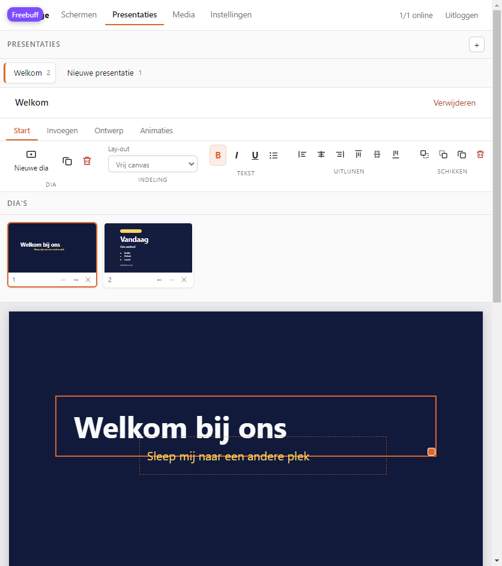

# Signage — gratis digitale signage voor Windows en Chrome OS

Een kleine, zelf-gehoste signage-app: zet vanaf je laptop of telefoon slides en video's in
een playlist, en elk scherm (Windows-pc, Chromebook, smart-tv, Raspberry Pi) toont die
playlist in de browser. Geen account, geen abonnement, geen reclame — alleen Node.js.

- **Beheer**: één webpagina met schermen, playlists, planning en media.
- **Speler (ontvanger)**: gewone webpagina die fullscreen werkt, installeerbaar is als app
  (PWA) en blijft doorspelen als de zender of het netwerk wegvalt.
- **Presentatiebouwer**: bouw presentaties met meerdere slides in een PowerPoint-achtig lint
  (Start, Invoegen, Ontwerp, Animaties): zeven lay-outs, vrij canvas met vormen, tekststijlen,
  verlopen, elementanimaties en overgangen — naast geüploade bestanden, Google Presentaties en
  andere webpagina's.
- **Kosten**: €0. Geen dependencies, geen cloud; het draait op je eigen computer.



## Zender en ontvanger

Dezelfde app heeft twee rollen:

- **Zender** — de computer met het beheer: schermen, media, slides en planning. Daar maak je
  alles klaar en van daaruit wordt het verstuurd.
- **Ontvanger** — de computer of Chromebook die alleen toont. De player-link haalt de playlist
  op, bewaart hem lokaal (playlist in localStorage, mediabestanden in IndexedDB) en speelt
  daarna altijd uit die lokale kopie.

Daardoor blijft het werken als één van de twee uitvalt:

| Situatie | Wat er gebeurt |
| --- | --- |
| Zender even offline | Ontvanger speelt door met de lokale kopie; linksonder verschijnt een klein oranje lampje. |
| Ontvanger start opnieuw (ook zonder netwerk) | Ontvanger begint meteen uit de lokale kopie en synchroniseert zodra de zender er weer is. |
| Wijziging op de zender | Ontvanger ziet hem binnen ±20 seconden en haalt de nieuwe bestanden binnen. |
| Zender voorgoed weg | Ontvanger blijft doorspelen met de laatst ontvangen inhoud. |

## 1. Starten

Node.js 18 of nieuwer is genoeg.

```bash
cd signage
node server.js
```

Bij de eerste start wordt een wachtwoord gemaakt en opgeslagen in
`signage/data/admin-password.txt`. Dat staat ook in de console. Open daarna:

```
http://localhost:8100/            <- beheer
```

De console toont ook een netwerk-adres (bijv. `http://192.168.1.24:8100`). Gebruik dat adres
op de Chromebook of een andere pc in hetzelfde wifi-netwerk.

Op Windows kun je ook `start.cmd` dubbelklikken: die start de server en opent het beheer.

## 2. Een scherm toevoegen

1. Tab **Schermen** → **+ Nieuw**.
2. Voeg slides toe: kies media bij **+ Media**, of plak een URL (bijv. een gepubliceerde
   Google Slides-link) bij **+ URL**.
3. Stel per slide de duur in seconden in en het weekrooster (zie hieronder).
4. Kopieer de **player-link** en open die op het scherm.

### Presentaties bouwen

Tab **Presentaties** → **+ Nieuw**. Een presentatie is een reeks slides; in de strip zie je
ze naast elkaar en kun je ze herordenen (← →), dupliceren of verwijderen. De bouwer werkt
als in PowerPoint: boven de dia staat een lint met de tabbladen **Start**, **Invoegen**,
**Ontwerp** en **Animaties**, met knoppen en pictogrammen voor dia's, tekst, uitlijnen,
vormen, kleuren, overgangen en animaties. Rechts staat het paneel **Opmaak** voor de inhoud
van de geselecteerde dia of het geselecteerde element.

Schermen, spelers en playlists staan bewust op het tabblad **Schermen**: daar zet je een
presentatie op een scherm (met **+ Presentatie** in de playlist). De bouwer zelf gaat alleen
over het maken van de presentatie.

Elke slide heeft:

- **Lay-out** — titel, titel met bullets, afbeelding links, afbeelding rechts, volledige
  afbeelding met tekst, een citaat, of **vrij canvas**.
- **Titel, ondertitel, bullets en voettekst** (bullets: één regel per punt).
- **Kleuren** voor achtergrond, tekst en accent, plus een **verloop** (tweede kleur en hoek)
  en een afbeelding met donkerte-instelling.
- **Uitlijning** en **tekstgrootte** (70–150%), en **notities** die alleen in het beheer zichtbaar zijn.

**Vrij canvas.** Kies bij Lay-out voor *Vrij canvas (slepen)*; de preview wordt dan een
werkblad. Met **+ Tekst**, **+ Afbeelding**, **+ Vorm** en **+ Lijn** voeg je blokken toe, je
sleept ze naar hun plek en met het hoekje rechtsonder schaal je ze. Klik een blok aan om in
het paneel eronder alles te zetten:

- **Tekst** — inhoud, grootte, kleur, vet, cursief, onderstreept, bullets, uitlijning,
  verticale uitlijning, regelafstand en letterafstand.
- **Vorm** — rechthoek, afgeronde rechthoek, cirkel, driehoek, lijn, pijl of ster, met eigen
  vulling, randkleur en randdikte.
- **Algemeen** — achtergrond, ronding, doorzichtigheid, afbeelding met vulling (vullen of
  passend), volgorde (naar voren/achteren), dupliceren, verwijderen en uitlijnen tegen de
  randen of het midden van de dia.
- **Effecten** — rotatie (−180°…180°), spiegelen (horizontaal/verticaal), schaduw en een
  lettertype: sans, serif, mono of display.
- **Animatie** — vervagen, omhoog of inzoomen, met vertraging; die speelt alleen op het echte
  scherm, niet in de preview.

Alles staat in procenten van de dia, dus dezelfde slide klopt op een breed scherm én op een
staand scherm; blokken blijven binnen het beeld en snappen op tienden van een procent.
Wissel je van een vaste lay-out naar vrij canvas, dan wordt de titel als eerste tekstblok
overgenomen.

**Diaformaat en thema's.** Onder **Ontwerp** staat het diaformaat: 16:9 (breed), 4:3
(klassiek), 9:16 (staand, voor een portret-scherm) of 1:1 (vierkant). De preview, de
miniaturen en de PDF-uitvoer volgen dat formaat meteen. Zes thema's (Middernacht, Papier,
Zwart-wit, Oranje, Bos, Poeder) zetten in één klik achtergrond, tekst, accent en verloop
klaar; daarna pas je ze nog vrij aan met de kleurkiezers. Het lettertype van de dia kies je
naast het formaat (sans, serif, mono of display).

**Overgang per dia en verbergen.** Onder **Animaties** kies je de overgang van de hele
presentatie én, apart, van deze ene dia (of *zelfde als presentatie*). Met **Dia verbergen**
blijft een dia in de bouwer staan — handig als tussenstap — maar slaat de speler hem over;
in de strip wordt hij lichter weergegeven. Duur, notities en overgang horen bij de dia en
worden met **Slide bijwerken** bewaard.

**Sneltoetsen.** Pijltjes verplaatsen het geselecteerde blok (0,5%, met Shift 2%),
`Delete` verwijdert het, `Esc` deselecteert, `Ctrl+D` dupliceert een blok of, zonder
selectie, de dia.

**PDF en afdrukken.** Met **PDF / afdrukken** boven de dia opent een printbaar overzicht van
alle zichtbare dia's, elk op een eigen pagina. Kies in het afdrukvenster *Opslaan als PDF*
om er een PDF van te maken. Notities staan onder de dia en worden niet meegeprint.

De preview ernaast is precies wat het scherm laat zien. Met **+ Naar scherm** zet je de hele
presentatie in de playlist; de ontvanger speelt hem slide voor slide af en daarna gaat de
playlist gewoon verder met het volgende item. Duur, weekrooster en periode stel je op
playlist-niveau in, net als bij media en URL's.

### Google Presentaties en andere webpagina's

Plak bij **+ URL** de gewone deel-link van een presentatie. De app maakt er automatisch een
embed-link van die start en doorloopt:

`https://docs.google.com/presentation/d/<id>/embed?start=true&loop=true&delayms=0`

Dat werkt voor elke webpagina die in een iframe mag. Let op: URL-slides hebben internet
nodig — ze worden niet lokaal bewaard, anders dan geüploade bestanden en slides uit de
bouwer. Voor een storing-vrije opstelling kun je dus beter een eigen slide of afbeelding
gebruiken.

### Planning per slide

Onder elke slide staat het rooster:

- **Dagen** — klik `ma` … `zo` aan. Niets aangeklikt betekent elke dag.
- **Tijdvak** — bijvoorbeeld `08:00`–`17:30`. Leeg laten is de hele dag. Een tijdvak dat
  over middernacht loopt (`22:00`–`06:00`) werkt ook: de aangeklikte dag is dan de dag
  waarop het tijdvak *begint*.
- **Periode** (optioneel) — vanaf/tot een datum, bijvoorbeeld alleen in december. Dit staat
  naast het weekrooster: beide moeten kloppen.

De chip achter de naam vat het samen, bijvoorbeeld `ma wo vr · 08:00–17:30`. Verandert een
rooster terwijl het scherm speelt, dan pakt de speler dat bij de volgende slide vanzelf op.

## 3. Op het scherm zetten

**Windows** (Chrome of Edge):

```bat
chrome --kiosk "http://192.168.1.24:8100/player?k=JOUW-SLEUTEL"
```

Of dubbelklik `player-kiosk.cmd` en plak de link. Sluit je kiosk af met `Alt+F4`.

**Chromebook**: open de player-link in Chrome. Zet hem op volledig scherm met de
volledig-scherm-toets (de toets met de vierkantjes, of `F11` op externe toetsenborden).
Voor een vaste app: menu ⋮ → *Cast, opslaan en delen* → **Pagina als app installeren**.
De player vraagt zelf om volledig scherm zodra je hem aanraakt.

**Belangrijk op een Chromebook**: laat hem niet in slaap vallen. Instellingen → Apparaat →
Energiebeheer → *Bij inactiviteit scherm uitschakelen* op **nooit**. De player vraagt via de
Wake Lock API om wakker te blijven zolang het tabblad zichtbaar is.

## 4. Toegang vanaf buiten je netwerk

Standaard luistert de server op je hele netwerk, dus iedereen op je wifi kan meebeheren.
Wil je het scherm op een andere locatie, dan zijn er twee gratis routes:

- **Cloudflare Tunnel** (gratis account): `cloudflared tunnel --url http://localhost:8100`
  geeft een publieke https-link zonder routerinstellingen.
- **Eigen port-forward** in de router naar poort 8100, bij voorkeur achter een reverse proxy
  met https.

Beide zetten het beheer op internet: wijzig dan eerst het wachtwoord in **Instellingen**.

## 5. Windows-installer

Voor Windows is er een native installer in Rust (`installer/`). Die is zelfstandig: de app
(server + beheer + speler) zit in de executable, dus je hebt geen zip of Node-pakketten nodig.
De kant-en-klare versie staat bij de **Releases** van deze repo
(`Signage-Setup.exe`, 1.3.1); zelf bouwen kan met `installer\build.cmd`.

Verwijderen gaat via **Start → Signage verwijderen**, *Apps en onderdelen* of
`Signage-Setup.exe --uninstall`. De installer zoekt de bestaande installatie op — via een
expliciete `--dir`, het bij de installatie bewaarde pad, de registersleutel of de
standaardmap — en controleert eerst of daar echt `app\server.js` staat. De map waarin de
setup zelf staat (je downloadmap bijvoorbeeld) wordt nooit opgeruimd. Staat de setup
toevallig in de installatiemap, dan blijven die map en het setup-bestand staan en
verdwijnen alleen de app-bestanden.

## Updates

Bij het starten vraagt de server één keer de nieuwste release op bij
`github.com/DrIamlegion/signage`. Is die nieuwer dan de draaiende versie, dan verschijnt in
het beheer een banner met **Download installer** en daaronder de release-opmerkingen zelf,
uitklapbaar en met dezelfde tekst als op GitHub — je hoeft dus niet naar GitHub om te lezen
wat er veranderd is. Onder **Instellingen → Over** staat je versie en kun je zelf
controleren. **Later** verbergt de banner tot de volgende versie. De ontvanger zelf toont
bij de eerstvolgende start eenmalig een kleine melding **Nieuwe versie x.y.z beschikbaar**
rechtsboven; die verdwijnt na twaalf seconden, blokkeert de playlist niet en verschijnt per
versie maar één keer.

De controle is bewust voorzichtig: geen internet of een geblokkeerde GitHub-API is geen
fout — de app start gewoon door en probeert het later opnieuw (hooguit elke 10 minuten,
anders elke 6 uur). Er wordt niets automatisch gedownload of geïnstalleerd; je kiest zelf
wanneer je de nieuwe setup uitvoert. Voor een eigen mirror of testomgeving kun je de
voedings-URL overschrijven:

```bash
SIGNAGE_UPDATE_FEED="https://mijn-server/release.json" node server.js
```

1. Dubbelklik `Signage-Setup.exe`.
2. Bevestig de installatiemap en eventueel een bureaubladsnelkoppeling.
3. De installer zet de app in `%LOCALAPPDATA%\Programs\Signage`, maakt snelkoppelingen in
   het startmenu en registreert zich bij *Apps en onderdelen*. Beheerderstoegang is niet nodig.
4. Daarna opent het beheer in je browser; het wachtwoord staat in
   `%LOCALAPPDATA%\Signage\data\admin-password.txt`.

De installer is tegelijk de launcher:

| Opdracht | Wat het doet |
| --- | --- |
| `Signage.exe` | server starten en het beheer openen |
| `Signage.exe --serve --no-browser` | server starten zonder browser (voor autostart) |
| `Signage.exe --stop` | de server stoppen |
| `Signage.exe --uninstall` | verwijderen; vraagt of de gegevens mee mogen |
| `Signage-Setup.exe --silent --desktop --autostart` | stille installatie met snelkoppelingen |
| `Signage-Setup.exe --firewall` | firewall-regel voor poort 8100 toevoegen (vraagt beheerdersbevestiging) |
| `Signage-Setup.exe --firewall-remove` | die regel weer verwijderen |
| `Signage-Setup.exe --no-firewall` | installeren zonder firewall-regel |

De installer heeft een eigen icoon — in de exe, op de snelkoppelingen en bij *Apps en
onderdelen* — en vraagt tijdens de installatie of poort 8100 in de firewall mag worden
vrijgegeven voor privé- en domeinnetwerken. Zeg je nee, dan blijven alleen toestellen op
deze computer bereikbaar. De regel is met `--firewall-remove` of bij het verwijderen zo weer
weg.

Gegevens staan buiten de installatiemap (`%LOCALAPPDATA%\Signage\data`), dus opnieuw
installeren of bijwerken laat je playlists en media staan. Zelf bouwen: `installer\build.cmd`
(vereist Rust en Node.js 18+ om te draaien).

## 6. Hoe het werkt

```
signage/
├─ server.js            # HTTP-server, API, opslag, uploads (geen dependencies)
├─ public/
│  ├─ admin.html/.css/.js   # beheer-UI
│  ├─ player.html/.css/.js  # speler
│  ├─ sw.js                 # offline cache voor de speler
│  └─ icon.svg
└─ data/                # automatisch aangemaakt
   ├─ db.json           # schermen, playlists, media-lijst
   ├─ media/            # geüploade bestanden
   └─ admin-password.txt
```

- De speler haalt elke 20 seconden de playlist op; wijzigingen in het beheer zijn dus binnen
  een halve minuut zichtbaar. Elke 15 seconden stuurt hij een heartbeat, waaruit de status
  **online/offline** in het beheer komt.
- Offline: de laatste playlist wordt lokaal bewaard en afbeeldingen/PDF's worden gecacht.
  Video's spelen alleen als de server bereikbaar is (die worden niet gecacht wegens grootte).
- Back-up: kopieer de map `signage/data` — daarin zit alles.

## 6. Wat het (nog) niet doet

- Geen .pptx-import of -export en geen PDF/PNG-export van een presentatie: slides leven in
  Signage zelf (wel: dezelfde dia-opbouw, vormen, verlopen, animaties en overgangen).
- Geen lay-outs met meerdere zones (wel: één slide tegelijk, beeldvullend of passend).
- Geen gebruikersbeheer: één wachtwoord voor het beheer.
- Geen proof-of-play-rapportage.

Dat is precies de functieset waar betaalde signage-pakketten per scherm voor rekenen; hier
zijn het bewust weggelaten snufjes.
